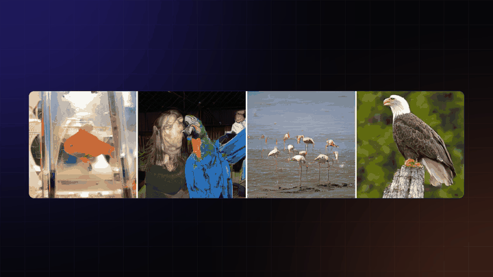
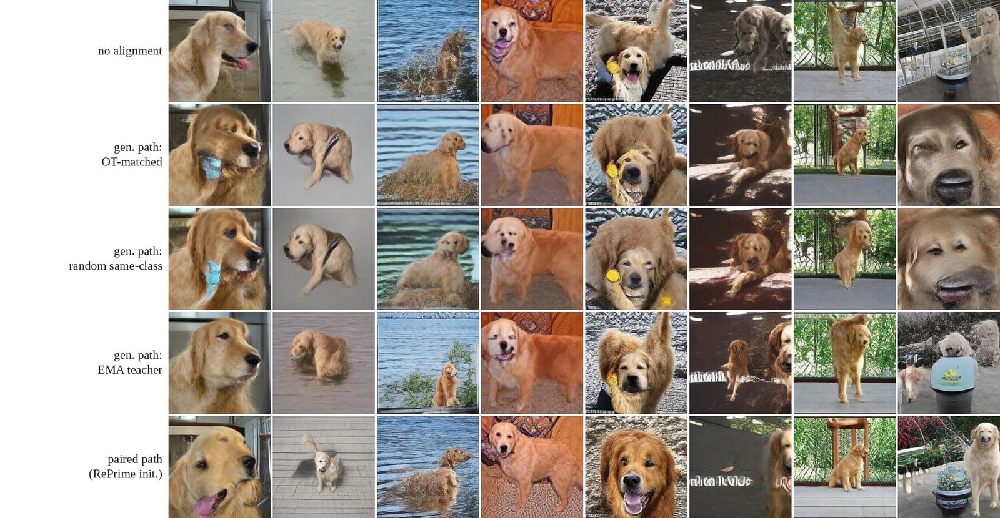

<div align="center">

<h1>Align the Pair, Not the Sample</h1>
<h3>Representation Alignment for Faster and Better One-Step Generators</h3>

<p><strong>Anonymous Authors</strong></p>

<p>
  <a href="https://mingxiao-li.github.io/RePrime/"></a>
  <a href="https://mingxiao-li.github.io/RePrime/"></a>
  <a href="https://github.com/Mingxiao-Li/RePrime"></a>
</p>

<p><em>One-step ImageNet 256² generation in a single network evaluation, without guidance.</em></p>

</div>


<p align="center"><sub>RePrime-L samples · one forward pass · FID <b>1.155</b> on ImageNet 256².</sub></p>

---

**RePrime** is a representation-alignment recipe for **Priming-style one-step
generators**. A Priming model is trained on two kinds of inputs: corrupted real
images, which come with a clean counterpart, and pure noise, which comes with
nothing. We show that the *same* REPA-style alignment loss helps on one path and
collapses diversity on the other. Aligning the **paired reconstruction path**
with a frozen DINOv2 teacher accelerates both training stages and improves the
final model; aligning the **generative path** fails in all 17 configurations we
tested. The projector is discarded after training, so inference is unchanged.

<div align="center">

| 2× fewer priming epochs | 4× fewer OT updates | FID 1.155 (L) | 24× less compute than WF-XL/2 |
|:---:|:---:|:---:|:---:|
| 80 ep match the 160-ep baseline | 3.75k updates match 25k | 1 NFE, no guidance | RePrime-B vs WF-XL/2 |

</div>

## Method

[](media/method.mp4)

<p align="center"><sub><a href="media/method.mp4">▶ Watch the full 15-second explainer (MP4, with music)</a> · also on the <a href="https://mingxiao-li.github.io/RePrime/">project page</a>.</sub></p>

RePrime adds one term to Priming's reconstruction stage:

```text
L = L_rec(G_θ(x_s, c), x_0) + λ · L_align(h^ℓ(x_s, c), E(x_0))
```

* `x_s = 0.2 x_0 + 0.8 ε` is the corrupted real image; `x_0` is its clean counterpart.
* `E` is a frozen **DINOv2-L/14**; patch tokens are compared one-to-one with the
  generator's patch grid (class tokens excluded).
* `h^ℓ` is an intermediate block: **block 5 of 16** for B, **block 10 of 32** for L.
* `P_ψ` is a two-layer GELU MLP (width 1024) trained with AdamW. It is **discarded
  after priming**, so there is no inference-time cost.
* `λ = 0.5`, applied for the **whole priming run**; Stage 2 (OT post-training) is unchanged.

**Why the paired path?** When the alignment target is independent of the input
given the class, the optimal aligned feature is constant within each class, so
the loss can only pull all samples toward a class prototype. A corrupted image
`x_s` still reveals its own `x_0`, so the paired path carries instance
information and alignment rewards features that describe *this* image.

**RePrime-J** interleaves OT updates on noise with aligned reconstruction every
other step, producing a *native* one-step generator without a separate
post-training stage.

## Results

### ImageNet 256×256, one network evaluation, no guidance

| Method | Priming ep. | EFLOPs | FID ↓ | FDr⁵ ↓ | Prec. ↑ | Rec. ↑ |
|---|---:|---:|---:|---:|---:|---:|
| Priming-B | 160 | 124.2 | 1.373 | 11.27 | .784 | .620 |
| **RePrime-B** | 160 | 157.3 | **1.303** | **10.20** | .781 | .639 |
| **RePrime-B, block 8** | 160 | 157.3 | **1.268** | **9.82** | .781 | **.641** |
| Priming-L | 160 | 239.0 | 1.174 | 7.41 | .779 | .648 |
| **RePrime-L** | 160 | 272.1 | **1.155** | **6.43** | .781 | .644 |
| **RePrime-J-B** † | 160 | 346.8 | **1.224** | 10.60 | .779 | .640 |

<sub>EFLOPs count both training stages and the frozen teacher. † Native one-step
model trained with 200k joint updates, then refined with 25k OT updates; native
FD₅ is 9.75 before refinement. FID/FDr⁵ average three sampling seeds.</sub>

### Same noise, same class



<p align="center"><sub><a href="media/compare.mp4">▶ Full comparison video (MP4)</a> · Priming-L → RePrime-L, 160 epochs, native 256×256 samples.</sub></p>

### Two stages, both faster

* **Fewer priming epochs.** RePrime-B at **80 epochs** matches Priming-B at 160
  (FD₅ 11.24 vs. 11.27); at 120 epochs it surpasses the 200-epoch baseline.
* **Fewer OT updates.** From the 160-epoch initialization, **3.75k** updates
  reach the baseline's final FD₆ of 9.51, and **6.25k** surpass it — 4× fewer.
  At 40 epochs, 2.5k updates match 22.5k — **9× fewer**.
* **Matched compute.** RePrime-B at 80 epochs uses **2.5% less total compute**
  than Priming-B at 120 (102.3 vs. 105.0 EFLOPs) and is better on every metric.
* **The frontier.** RePrime-B beats WF-XL/2 with **24× less training compute**
  (157.3 vs. 3744.4 EFLOPs).

### What the ablation says

* **Teacher.** DINOv2 improves FD₆ by 16.5% at 40 epochs; aligning to the OT
  ResNet-MAE space gives 6.0%, and ConvNeXt only 1.3%. At full budget, MAE and
  ConvNeXt alignment even hurt. The teacher should be semantic and *outside* the
  spaces the OT loss already matches.
* **Depth.** Mid-network wins: block 8 of 16 reaches FD₆ 8.28 at 160 epochs.
* **Window.** Unlike diffusion, the benefit grows with the full priming window;
  stopping alignment early does not help.
* **Correspondence.** Random same-class targets recover only 12–16% of the gain;
  permuted tokens recover 54%; the image's own target recovers all of it.

<p align="center">
  
</p>
<p align="center"><sub>Prototype attraction: the same eight noise vectors, five post-training recipes. Generative-path alignment produces typical, close-up modes; RePrime preserves coverage.</sub></p>

---

## Installation

Linux x86-64, Python 3.11, PyTorch 2.6.0 / CUDA 12.4. The pinned environment is
in [`requirements.txt`](requirements.txt).

```bash
git clone https://github.com/Mingxiao-Li/RePrime.git
cd RePrime

# Option A: conda + pip
conda create -n priming python=3.11.15 -y
conda activate priming
pip install -r requirements.txt

# Option B: the setup helper (creates the `priming` env)
bash scripts/create_env.sh

export PYTHONNOUSERSITE=1
python scripts/check_environment.py          # CPU / package check
python scripts/check_environment.py --cuda   # inside a GPU allocation
```

`bash scripts/create_env.sh` runs `conda env create -f environment.yml` and then
`pip check` + `check_environment.py`. Use `--prefix /path/to/env` to place the
environment on scratch storage.

## Data and assets

The repository does **not** ship ImageNet, encoder weights, or checkpoints.
The code resolves paths from the repository root by default:

```text
data/imagenet/imagenet-latents-images/    # packed ImageNet (Arrow)
assets/ot/representations/                # converted MAE + ConvNeXt, calibration, indices
assets/lpips/vgg.pth
assets/torch/ and assets/huggingface/     # timm / torchvision / DINOv2 caches
checkpoints/                              # generator checkpoints
```

Either place them there or symlink an external storage root:

```bash
ln -s /scratch/reprime/data data
ln -s /scratch/reprime/assets assets
ln -s /scratch/reprime/checkpoints checkpoints
```

### Packed ImageNet

The official packed dataset is the gated
[`jaykim1102/priming`](https://huggingface.co/datasets/jaykim1102/priming)
dataset: 1,281,167 train + 50,000 validation RGB 256×256 images, about 259 GB.
Accept the ImageNet terms on the dataset page, then:

```bash
hf auth login
python scripts/download_assets.py --group dataset
```

The helper verifies the release. A locally built Arrow dataset is compatible
only if it preserves the same row ordering, because the OT calibration and
class indices are tied to it.

### Pretraining, post-training, and evaluation assets

```bash
python scripts/download_assets.py --group pretraining    # LPIPS, VGG16, ConvNeXt V2
python scripts/download_assets.py --group posttraining   # diagnostic encoders / stats
python scripts/download_assets.py --group conversion     # MAE / ConvNeXt conversion inputs
python -m pip install -r old/environment/requirements-conversion.txt
python scripts/convert_ot_encoders.py                    # once; refuses to overwrite

python scripts/download_assets.py --group evaluation     # FID / FDr5 references
```

The DINOv2-L/14 teacher is loaded through `timm`. The code sets the Hub offline
flag during training, so populate the cache once:

```bash
export HF_HOME="$PWD/assets/huggingface"
python -c "import timm; timm.create_model('vit_large_patch14_dinov2.lvd142m', pretrained=True)"
```

Use `--data-path`, `--encoder-cache`, `--hf-home`, `--torch-home`, and
`--lpips-weights` for absolute paths. See
[`documentation/setup.md`](documentation/setup.md) and
[`documentation/assets.md`](documentation/assets.md) for the full asset map.

## Training

All recipes use **8 torchrun ranks**, global batch 1,024 (microbatch 64,
accumulation 2), BF16, Muon, and constant EMA 0.9999. Use H100 80GB or H200 for
B; use H200s for L post-training.

### RePrime-B (main)

```bash
NPROC=8 bash scripts/train_pretrain.sh \
  configs/pretrain/reprime_b_160.yaml \
  outputs/pretrain/reprime_b
```

### RePrime-L

```bash
NPROC=8 bash scripts/train_pretrain.sh \
  configs/pretrain/reprime_l_160.yaml \
  outputs/pretrain/reprime_l
```

### RePrime-B with the best depth (block 8)

```bash
NPROC=8 bash scripts/train_pretrain.sh \
  configs/pretrain/reprime_b_160_blk8.yaml \
  outputs/pretrain/reprime_b_blk8
```

### RePrime-J (single-stage)

```bash
NPROC=8 bash scripts/train_pretrain.sh \
  configs/pretrain/reprime_joint_b_160.yaml \
  outputs/pretrain/reprime_j
```

Optionally refine the native joint model with the official 25k OT recipe:

```bash
INIT=outputs/pretrain/reprime_j/checkpoints/latest.pth NPROC=8 \
  bash scripts/train_posttrain.sh \
  configs/posttrain/reprime_b_160.yaml \
  outputs/posttrain/reprime_j
```

### OT post-training

The post-training recipe is identical to Priming; only the initialization
changes. Pass the RePrime checkpoint:

```bash
INIT=outputs/pretrain/reprime_b/checkpoints/latest.pth NPROC=8 \
  bash scripts/train_posttrain.sh \
  configs/posttrain/reprime_b_160.yaml \
  outputs/posttrain/reprime_b
```

For L, use `configs/posttrain/reprime_l_160.yaml` and the L checkpoint. For
RePrime-J, initialize the same B post-training recipe with the joint checkpoint
to reproduce the refined 1.224 FID.

### Smoke checks

```bash
# 2 updates of RePrime-B on one GPU (data + alignment + DDP + checkpointing)
NPROC=1 bash scripts/train_pretrain.sh \
  configs/pretrain/reprime_b_160.yaml outputs/smoke/pretrain --smoke-steps 2

# 2 updates of OT post-training on two GPUs; pipeline check only.
# smoke_nocompile.yaml disables torch.compile for the low-memory check.
PRIMING_CKPT_GEN=1 DRIFT_COMPILE=0 \
  INIT=outputs/smoke/pretrain/checkpoints/latest.pth NPROC=2 \
  bash scripts/train_posttrain.sh \
  configs/posttrain/smoke_nocompile.yaml outputs/smoke/posttrain --smoke-steps 2
```

The official OT recipe uses 16 global classes × 64 samples × 128 references per
step. A single 143 GB H200 cannot hold it (about 139 GB is allocated before the
last allocation); use at least two ranks for the smoke and eight for paper
numbers. The two-update smoke above disables `torch.compile` to keep the
pipeline check small.

Resume with `--resume outputs/.../checkpoints/latest.pth`; use a fresh output
directory for every new run. `--check-config` validates a recipe without data or
GPUs:

```bash
python pretrain.py --config configs/pretrain/reprime_b_160.yaml --check-config
python posttrain.py --config configs/posttrain/reprime_b_160.yaml --check-config
```

## Evaluation and sampling

### Official FID / FDr⁵

```bash
NPROC=4 bash scripts/eval_paper.sh \
  priming_l_160 \
  outputs/posttrain/reprime_l/checkpoints/step_025000.pth \
  outputs/eval/reprime_l
```

`--model` selects the architecture (`priming_b_160` or `priming_l_160`); a
RePrime checkpoint uses the same architecture name. The paper protocol is
50,000 images, 3 seeds, batch 32, 4 ranks, FP32 Inception, and the JiT
reference. For a quick pipeline check, `NUM_IMAGES=1000 NPROC=1 ...` (the FID
number is not meaningful at 1,000 images).

### Sampling

```bash
python scripts/sample.py \
  --model priming_l_160 \
  --checkpoint outputs/posttrain/reprime_l/checkpoints/step_025000.pth \
  --num-images 16 --class-ids 207 \
  --output-dir outputs/samples/reprime_l
```

Saves individual PNGs and a `samples.json` record. Add `--stage pretraining`
and a pretraining checkpoint to sample the reconstruction-only model.

## Reproducing the paper

| Paper result | Pretraining | Post-training |
|---|---|---|
| Priming-B / 160 | `configs/pretrain/priming_b_160.yaml` | `configs/posttrain/priming_b_160.yaml` |
| Priming-L / 160 | `configs/pretrain/priming_l_160.yaml` | `configs/posttrain/priming_l_160.yaml` |
| **RePrime-B / 160** | `configs/pretrain/reprime_b_160.yaml` | `configs/posttrain/reprime_b_160.yaml` |
| **RePrime-B / 160, block 8** | `configs/pretrain/reprime_b_160_blk8.yaml` | `configs/posttrain/reprime_b_160.yaml` |
| **RePrime-L / 160** | `configs/pretrain/reprime_l_160.yaml` | `configs/posttrain/reprime_l_160.yaml` |
| **RePrime-J / 160** | `configs/pretrain/reprime_joint_b_160.yaml` | optional refinement with `posttrain/reprime_b_160.yaml` |

The full mapping, including teacher/depth/window/correspondence ablations and
the placement experiments, is in [`configs/README.md`](configs/README.md).
Ablations use the sanctioned 40-epoch protocol; the main numbers use 160 epochs.
The correspondence-control arms (`abl_corr_*`) use `pretrain_e2.py` on two ranks.

## Code structure

```text
.
├── pretrain.py                 # reconstruction pretraining + RePrime alignment + RePrime-J
├── pretrain_e2.py              # E2 correspondence-control entry point (2 ranks)
├── posttrain.py                # OT distribution matching (official Priming recipe)
├── eval.py                     # official FID / FDr5 evaluation
├── models/
│   ├── priming.py              # one-step generator (OST-B / OST-L)
│   └── encoders/               # frozen encoders (perceptual, OT, FID, SIM)
├── losses/
│   ├── alignment.py            # REPA head: paired / generative-path targets
│   ├── matching.py             # feature-space OT / energy / Laplacian matching
│   └── reconstruction.py       # adaptive pixel + perceptual losses
├── data/imagenet.py            # packed ImageNet, B/L preprocessing, OT streams
├── utils/                      # config, paths, checkpoints, EMA, Muon, DDP
├── metrics/                    # FID / FDr5 / precision-recall
├── configs/
│   ├── pretrain/               # Priming / RePrime B, L, joint, ablations
│   └── posttrain/              # OT recipes + placement experiments
├── scripts/
│   ├── create_env.sh           # conda environment
│   ├── download_assets.py      # verified asset downloader
│   ├── convert_ot_encoders.py  # MAE / ConvNeXt conversion
│   ├── sample.py               # sampling
│   ├── train_pretrain.sh       # torchrun wrapper
│   ├── train_posttrain.sh
│   └── eval_paper.sh
├── documentation/              # setup, assets, pretraining, post-training, evaluation
├── media/                      # README images, method video, comparison video
├── old/                        # released manifests, environment locks
├── docs/                       # project page (GitHub Pages)
├── requirements.txt
└── README.md
```

The core change relative to the official Priming implementation is contained in
`pretrain.py` (`compute_alignment`, `build_joint`, `joint_ot_step`) and
`losses/alignment.py`; `posttrain.py` and the OT machinery are unchanged.

## Citation

```bibtex
@misc{reprime2026,
  title  = {Align the Pair, Not the Sample: Representation Alignment for
            Faster and Better One-Step Generators},
  author = {Anonymous Authors},
  year   = {2026},
  note   = {Project page: https://mingxiao-li.github.io/RePrime/}
}
```

The author list will be updated after the anonymity period.

## Acknowledgements

This code builds on the official
[Priming](https://github.com/JaeyeonKim01/priming) implementation
(Park et al., *Are We Overthinking One-Step Generation?*, arXiv:2610.20331),
[REPA](https://github.com/sihyun-yu/REPA), [DINOv2](https://github.com/facebookresearch/dinov2),
[timm](https://github.com/huggingface/pytorch-image-models), and the
torch-fidelity / W-Flow encoders. We thank the original authors for releasing
their code and assets. The repository is released under the Apache 2.0 license;
vendor licenses under `models/encoders/` are preserved.

## Contact

For questions about the paper or code, please open an issue or use the contact
information on the project page.
