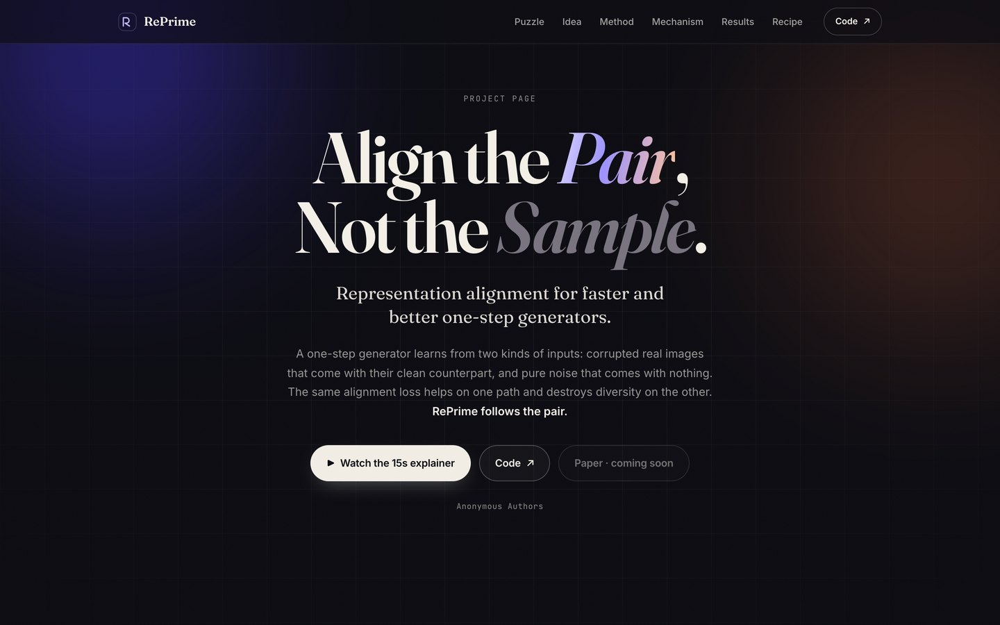

# RePrime — Project Page

> **Align the Pair, Not the Sample: Representation Alignment for Faster and Better One-Step Generators**  
> Project page · no venue or review information  
> **Live:** https://mingxiao-li.github.io/RePrime/

一个为论文制作的可直接部署的单页项目主页。纯 HTML / CSS / JavaScript，无构建步骤、无依赖安装，适合 GitHub Pages。



---

## 快速预览

在本目录运行任意静态服务器：

```bash
cd reprime_project_page
python3 -m http.server 8000
# 然后打开 http://localhost:8000
```

也可以直接双击 `index.html`（`file://` 下页面与图片都可用；Google Fonts 需要联网，断网时会自动回退到系统字体）。

---

## 部署到 GitHub Pages

完整逐步指南（含认证、验证清单、常见问题、自定义域名）见 **[DEPLOY.md](DEPLOY.md)**。最快路径：

### 推荐：放进 RePrime 仓库的 `docs/`

```bash
git clone https://github.com/Mingxiao-Li/RePrime.git
cd RePrime
mkdir -p docs
cp -R /Users/limingxiao/Documents/deepseek-working-dir/t2i/reprime_project_page/. docs/
git add docs
git commit -m "Add RePrime project page"
git push origin master
```

然后 **Settings → Pages** → Source: `Deploy from a branch` → `master` / `/docs` → Save。  
地址：`https://mingxiao-li.github.io/RePrime/`。

### 独立仓库

```bash
cd /Users/limingxiao/Documents/deepseek-working-dir/t2i/reprime_project_page
git init && git add . && git commit -m "RePrime project page"
git branch -M main
git remote add origin https://github.com/Mingxiao-Li/reprime-page.git
git push -u origin main
```

Pages → `main` / `/ (root)`。地址：`https://mingxiao-li.github.io/reprime-page/`。

### 用户主页仓库

仓库名必须是 `Mingxiao-Li.github.io`，页面放在根目录，Pages → `main` / `/ (root)`，地址 `https://mingxiao-li.github.io/`。

> 已包含 `.nojekyll`；复制/上传时一定要带上它，否则 GitHub 可能用 Jekyll 处理页面。
>
> **已部署：** https://mingxiao-li.github.io/RePrime/（`Mingxiao-Li/RePrime` 已改为 public，Pages 从 `master` / `docs` 发布，HTTPS 已强制）。

---

## 上线前替换清单

页面已使用 arXiv 版本的作者列表，且不包含任何会议名、审稿状态或投稿信息。需要修改时按下面清单操作：

| 要改什么 | 位置 |
|---|---|
| 作者与单位 | 已写入 Hero 与 BibTeX；修改时搜索 `Mingxiao Li` |
| 论文链接 | 页面上的 `Paper · coming soon` 占位；公开后把 PDF 放到 `assets/paper.pdf`，再把占位换成 `<a class="btn btn-primary" href="assets/paper.pdf">Paper</a>` |
| 补充材料 | 同上，放到 `assets/supp.pdf` 并新增按钮 |
| 代码链接 | 已指向 `https://github.com/Mingxiao-Li/RePrime`（导航、Hero、CTA、页脚共 4 处）；换仓库时全局替换即可 |
| 论文/arXiv 链接 | 公开后把 `Paper · coming soon` 占位换成链接 |
| BibTeX | `index.html` 底部 `#bibtex-code`，补全作者、booktitle、pages |
| 社交预览图 | 替换 `assets/img/og.jpg`（1200×630），并把 `<meta property="og:image">` 改成部署后的**绝对 URL** |
| 页面标题/描述 | `<title>`、`<meta name="description">`、`og:*` |
| 主色/字体 | `assets/css/style.css` 顶部 `:root` 变量；字体在 `<head>` 的 Google Fonts `<link>` |

`Paper` 按钮已指向 `assets/paper.pdf`；arXiv 链接公开后替换对应 `href` 即可。

> 注意：页面与代码仓库现在都已公开作者信息；如之后需要匿名版本，请另行部署。

---

## 文件结构

```
reprime_project_page/
├── index.html                 # 全部内容与文案
├── .nojekyll
├── README.md
├── DEPLOY.md                  # 完整部署指南（认证 / 验证 / 排错）
└── assets/
    ├── css/style.css          # 设计系统、布局、动效、响应式
    ├── js/main.js             # 交互：点云实验台、前沿图、灯箱、视频、复制等
    ├── video/
    │   ├── reprime_method.mp4   # 15s 方法解释视频（1280×720 · 2.3 MB · AAC 音乐）
    │   └── reprime_compare.mp4  # 9s 同噪声对比视频（1280×720 · 1.6 MB · AAC 音乐）
    └── img/
        ├── teaser.jpg         # Hero 样本墙
        ├── collapse.jpg       # 原型吸引（同噪声 5 种配方）
        ├── qualitative.jpg    # 同噪声定性对比
        ├── budget.png         # 两阶段加速曲线
        ├── mechanism.png      # 接口 / 语义路由
        ├── joint.png          # RePrime-J 联合训练
        ├── method-poster.jpg  # 方法视频封面
        ├── compare-poster.jpg # 对比视频封面
        ├── og.jpg             # 社交分享图
        ├── preview-hero.jpg   # 本 README 的预览图
        ├── x0.jpg xs.jpg      # 方法图的真实样本缩略图
        └── ...
```

---

## 页面结构（对应论文叙事）

1. **Hero** — 标题、一句话主张、样本墙、四个关键数字。
2. **TL;DR** — 两张输入路径 / 位置决定符号 / 给噪声修一扇门。
3. **01 The Puzzle** — 两条路径；可交互的 **Placement Bench**：切换「不对齐 / 对齐配对路径 / 对齐生成路径」，点云与 Recall、FD₆ 同步变化；随后是塌缩样本图与 17/17、20/20 的对照。
4. **02 The Idea** — 可对齐性命题（Proposition 1）的直白解释，以及「打断实例对应关系，收益随之消失」的条形图（FD₆ 22.10 → 18.10）。
5. **03 The Method** — 15 秒解释视频、三步流程图（加噪 → 预测 → 对齐）、真实样本缩略图、公式条、三个设计问答、成本条。
6. **04 The Mechanism** — 深色章节：接口出现在被对齐的 block；gap 与质量无关（ρ=0.00），语义路由才相关（ρ=−0.90）；随机目标对照。
7. **05 Results** — 可交互的 compute–FID 前沿散点图、主结果表、四项加速数字、预算曲线、同噪声对比视频、定性图、RePrime-J。
8. **06 The Recipe** — Teacher / Depth / Window 三张卡：跨空间教师、block 8、全窗口（与 diffusion 的直觉相反）。
9. **07 Takeaways** — 四条结论 + 局限 + 收束引语。
10. **CTA** — Code on GitHub、Paper 占位、BibTeX（一键复制）、返回顶部。

---

## 视频

页面内嵌了两段带原创 ambient 音乐的视频，都是 1280×720 / 30 fps / H.264 + AAC MP4（fast-start），点击播放、不自动播放：

| 文件 | 时长 | 位置 | 内容 |
|---|---|---|---|
| `assets/video/reprime_method.mp4` | 15 s | 03 Method | 两条路径、loss 挂在哪、projector 丢弃 |
| `assets/video/reprime_compare.mp4` | 9 s | 05 Results | 同噪声 Priming-L → RePrime-L 擦除对比（原生 256×256 样本） |

封面分别是 `assets/img/method-poster.jpg` 和 `compare-poster.jpg`。播放器使用原生 controls + 自定义播放按钮；`preload="none"`，离开视口自动暂停。

音乐由 numpy 合成的原创 ambient 音床（约 −20 dBFS），无版权问题；播放器原生 controls 可以随时静音。替换视频时保持 16:9 与 H.264 + AAC MP4，并同步更新 poster；如果分辨率变化，把 `<video>` 的 `width` / `height` 改成新尺寸即可。

---

## 设计与技术说明

- **字体**：Fraunces（标题衬线）+ Inter（正文）+ JetBrains Mono（数据标签），通过 Google Fonts 加载；断网时回退到 Iowan Old Style / Georgia / 系统无衬线，已测试标题仍是两行。
- **配色**：暖纸底色 `#F6F4EF`、墨黑 `#121118`、电光紫 `#3B2BF0`、珊瑚红 `#DE474C`（失败）、薄荷绿 `#0E9F6E`（成功）。深色 Hero 与 Mechanism 形成两次视觉换气。
- **交互**（原生 JS，无第三方库）：
  - Placement Bench：96 个确定性生成的点、三态布局、指标数字滚动；点云是**示意**，页面明确标注，右侧数字全部来自论文。
  - Frontier 图：根据论文表格数据现场生成 SVG；hover / focus 显示 tooltip；移动端改为横向滚动。
  - 图片 hover 放大与点击灯箱（Esc 关闭）。
  - 滚动进度、导航高亮、IntersectionObserver 逐段入场。
  - BibTeX 一键复制。
  - 视频：原生 `<video>` + 自定义播放按钮；poster、`preload="none"`、离开视口自动暂停、点击后才播放声音（不自动播放）。
- **可访问性**：所有交互可键盘操作；`prefers-reduced-motion` 下关闭动效；axe-core（WCAG 2A/AA）扫描 0 violations；对比度全部达标。
- **响应式**：1440 / 1024 / 820 / 390 宽度均验证无横向溢出；表格与前沿图在窄屏横向滚动。
- **性能**：首屏只加载 teaser、字体与 CSS/JS；其余图片 `loading="lazy"`；视频 `preload="none"`，点击播放才请求（封面仅约 100 KB）。

---

## 已验证

- 无 console error、无 404、无破图。
- 三种视口无页面级横向溢出；图片显示宽高比与原图一致。
- 滚动后所有 `reveal` 元素均入场（无空白段落）。
- 主标题在 Web Font 与系统字体两种情况下都保持两行。
- 两段视频均可在 Chrome 中播放（readyState 4，无解码错误），AAC 音频轨存在且可解码，封面与 MP4 请求均 200。
- axe-core WCAG 2A/AA：0 violations。
- 文案数字与论文表格逐项核对过；点云/示意部分已在页面上标注。
- 页面、OG 图、预览图、BibTeX 与 README 中均不含会议名、审稿状态或投稿信息。

---

## 素材

页面中的图由论文 `figures/` 下的 PDF 以 400 DPI 重新渲染为位图；样本图来自论文的 `teaser_samples.jpg`、`fig_collapse.jpg`、`fig_qualitative.jpg`。所有内容版权归论文作者所有。
